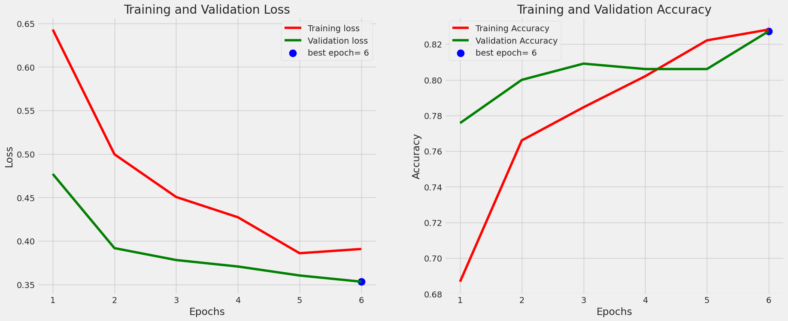

# Skin Cancer Detection using CNN

An academic deep-learning project that classifies skin lesion images as **benign** or **malignant**. I first built a custom CNN from scratch, then improved the results using transfer learning with **EfficientNetB7**.

> Educational project only. It is not a medical diagnostic tool.

## Results

| Model | Train accuracy | Validation accuracy | Test accuracy |
|---|---|---|---|
| Custom CNN (baseline, trained from scratch) | 45.4% | 45.5% | 45.5% |
| EfficientNetB7 (transfer learning) | 88.7% | 82.7% | **83.3%** |

The custom CNN predicted almost every image as malignant, so it did not learn to separate the two classes. Using a pretrained EfficientNetB7 base, frozen and with a new classifier head on top, improved test accuracy from about 45% to about 83%.

## Dataset
[Skin Cancer: Malignant vs Benign (Kaggle)](https://www.kaggle.com/datasets/fanconic/skin-cancer-malignant-vs-benign)
- 2,637 training images
- 330 validation and 330 test images (the dataset's test folder split 50/50, stratified by class)
- 2 classes: benign and malignant

## Tech stack
Python, TensorFlow/Keras, scikit-learn, NumPy, Pandas, Matplotlib, Seaborn, OpenCV, Pillow, KaggleHub

## What I did
1. Downloaded the dataset using KaggleHub and built image DataFrames of file paths and labels.
2. Loaded images with Keras `ImageDataGenerator` at 224x224 resolution (batch size 10).
3. Built a custom CNN with stacked Conv2D layers, BatchNormalization, MaxPooling and Dropout, trained with the Adamax optimizer. It reached only about 45% accuracy.
4. Built a second model using EfficientNetB7 (ImageNet weights, frozen base) with a Dense and Dropout classifier head.
5. Trained both models for 6 epochs, plotted the training curves, and evaluated on the train, validation and test sets.
6. Created a confusion matrix and classification report for the baseline model.

## Model details
- **Baseline CNN:** about 20.9M parameters, 5 convolution blocks, trained from scratch.
- **EfficientNetB7 model:** about 65.5M parameters, of which about 1.4M are trainable.
- Loss: categorical cross-entropy. Optimizer: Adamax.

## How to run
1. Open `Skin_Cancer_Detection_Using_Convolutional_Neural_Networks.ipynb` in Google Colab.
2. Go to Runtime, then Change runtime type, and choose GPU.
3. Run all cells. The dataset downloads automatically with `kagglehub`.

Local installation: `pip install tensorflow scikit-learn pandas numpy matplotlib seaborn opencv-python pillow kagglehub`

## Limitations and future improvements
- Trained for only 6 epochs, and the results can improve with longer training.
- Add data augmentation and unfreeze some EfficientNet layers for fine-tuning.
- Report precision and recall for the transfer-learning model. For medical screening, catching malignant cases (recall) matters most.
- Try other pretrained models and compare them.

## Author
Bibi Zainab – [LinkedIn](https://www.linkedin.com/in/bibi-zainab-dhalayat-929b2b41a) | [GitHub](https://github.com/zk946190-ui)
